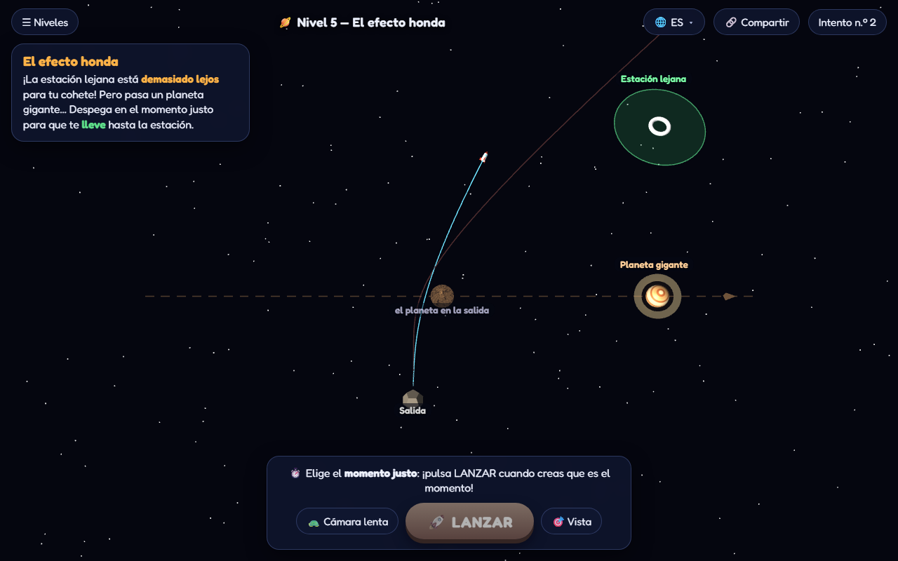
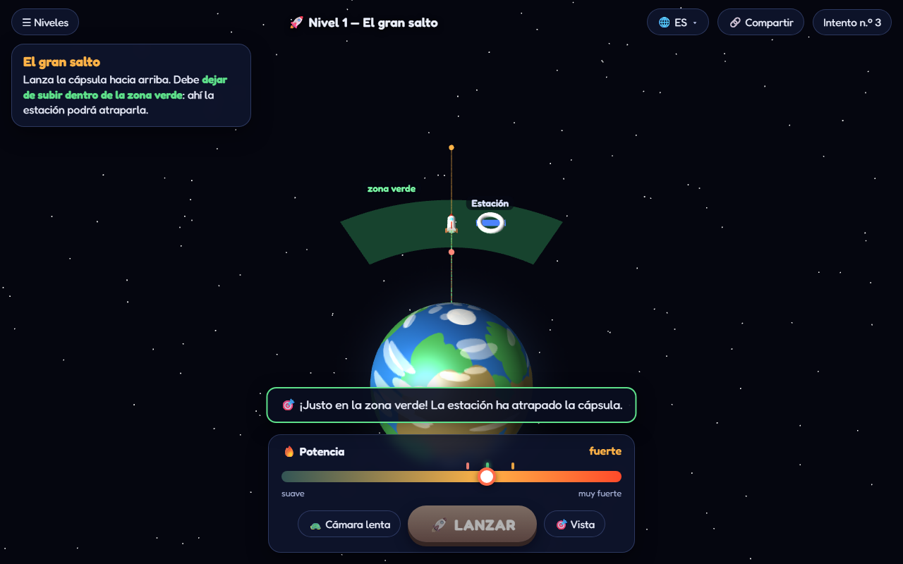
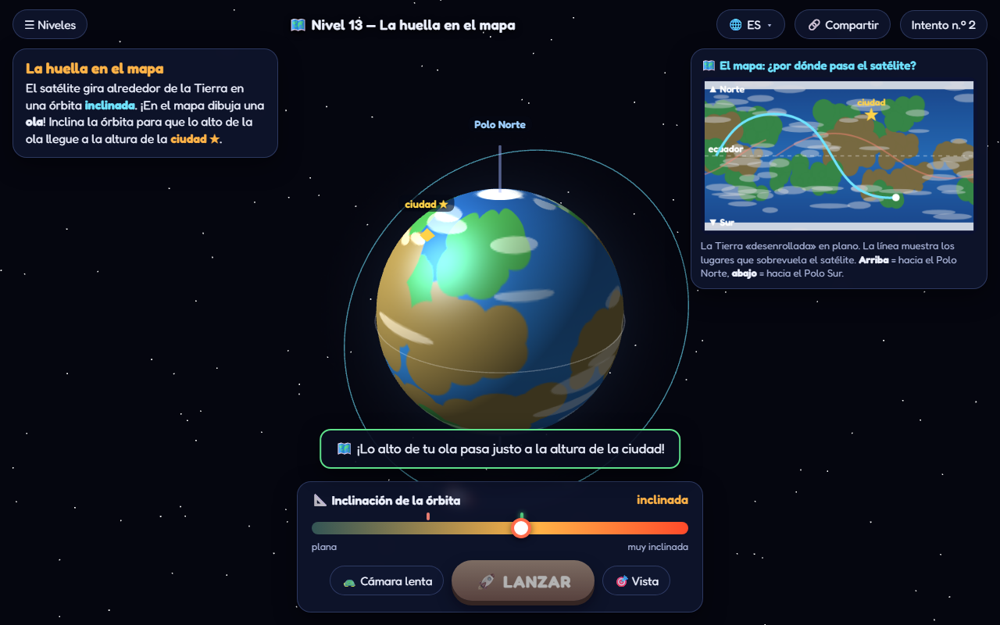
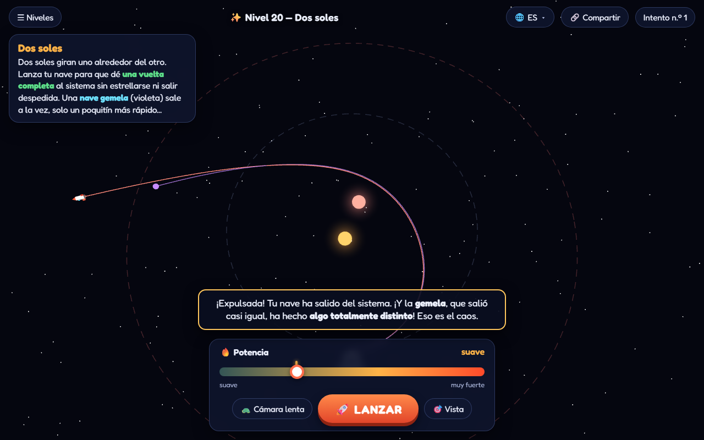

# ⭐ Star Nav

### ▶ [Jugar ahora: edu-fpar.github.io/star-nav](https://edu-fpar.github.io/star-nav/#nivel-1)

[English](README.md) · [Français](README.fr.md) · **Español**

Código fuente: [github.com/edu-fpar/star-nav](https://github.com/edu-fpar/star-nav)

**Un juego de navegación espacial en 3D para niños (de unos 8 años) que construye una intuición de la gravedad y de las trayectorias, sin una sola ecuación.**

---

## La idea

Casi todos conocimos la mecánica orbital, si acaso, como una página de fórmulas. Star Nav toma el camino contrario: **pruebas, miras lo que pasa, corriges**.

- Cada nivel tiene **uno o dos ajustes** (potencia, momento del despegue, fuerza del motor…).
- Un intento fallido se queda en pantalla como una **línea fantasma**, para corregir el siguiente a ojo.
- Los mensajes nunca dan cifras: *«¡Casi! Un poquitín más fuerte»*, *«¡Demasiado pronto! Has pasado por delante del planeta»*.
- Tras 3 intentos fallidos aparece una **pista**. Tras un acierto, una tarjeta **«Lo que acabas de descubrir»** pone la idea en palabras.

## Los 31 niveles

Cada título abre directamente el nivel en español.

**Parte 1 — Lo básico**

| # | Nivel | Lo que descubre el niño |
|---|---|---|
| 1 | [🚀 El gran salto](https://edu-fpar.github.io/star-nav/#nivel-1) | Cuanto más fuerte empujas, más alto llegas… y por encima de cierta velocidad, te escapas para siempre |
| 2 | [📦 Una cápsula más pesada](https://edu-fpar.github.io/star-nav/#nivel-2) | El mismo empujón mueve menos un objeto pesado |
| 3 | [🛰️ La vuelta a la Tierra](https://edu-fpar.github.io/star-nav/#nivel-3) | Un satélite siempre está cayendo, pero *alrededor* de la Tierra |
| 4 | [🌙 Cita con la Luna](https://edu-fpar.github.io/star-nav/#nivel-4) | Apunta adonde *estará* la Luna, no adonde está |
| 5 | [🪐 El efecto honda](https://edu-fpar.github.io/star-nav/#nivel-5) | Pasar por detrás de un planeta en movimiento da velocidad gratis |

**Parte 2 — Moverse por el espacio**

| # | Nivel | Lo que descubre el niño |
|---|---|---|
| 6 | [🌊 Vuelta a la Tierra](https://edu-fpar.github.io/star-nav/#nivel-6) | Para bajar se frena, y con mucha antelación |
| 7 | [🏃 Alcanzar la estación](https://edu-fpar.github.io/star-nav/#nivel-7) | La paradoja: para alcanzar a alguien en órbita hay que frenar |
| 8 | [🪜 Subir de nivel](https://edu-fpar.github.io/star-nav/#nivel-8) | Dos encendidos del motor, el segundo en lo alto del óvalo |
| 9 | [🛬 Aterrizaje suave](https://edu-fpar.github.io/star-nav/#nivel-9) | Mantener el motor para frenar contra la gravedad (y vigilar el combustible) |
| 10 | [🔴 Próxima parada: Marte](https://edu-fpar.github.io/star-nav/#nivel-10) | La ventana de lanzamiento solo vuelve de vez en cuando |

**Parte 3 — Leer gráficas**

| # | Nivel | Lo que descubre el niño |
|---|---|---|
| 11 | [📈 Dibujar el viaje](https://edu-fpar.github.io/star-nav/#nivel-11) | Una gráfica es el viaje dibujado en el tiempo (unas cuentas de colores unen el espacio y la gráfica) |
| 12 | [〰️ La ola de la órbita](https://edu-fpar.github.io/star-nav/#nivel-12) | Una órbita ovalada dibuja una ola que se repite; una redonda, una línea plana |
| 13 | [🗺️ La huella en el mapa](https://edu-fpar.github.io/star-nav/#nivel-13) | Una órbita inclinada dibuja una ola en un mapa plano, la de los carteles de las misiones espaciales |

**Parte 4 — Varios ajustes**

| # | Nivel | Lo que descubre el niño |
|---|---|---|
| 14 | [⛽ Llena el depósito](https://edu-fpar.github.io/star-nav/#nivel-14) | El combustible empuja, pero pesa: si hay demasiado, el cohete no despega |
| 15 | [👩‍🚀 Astronautas a bordo](https://edu-fpar.github.io/star-nav/#nivel-15) | Fuerte y corto o suave y largo; las personas necesitan el suave. Un cuaderno de a bordo dibuja cada intento |

**Parte 5 — Nuevos retos**

| # | Nivel | Lo que descubre el niño |
|---|---|---|
| 16 | [📍 Sobrevolar la ciudad](https://edu-fpar.github.io/star-nav/#nivel-16) | Inclinación *y* momento del lanzamiento: la Tierra gira bajo el satélite |
| 17 | [☄️ La honda perturbada](https://edu-fpar.github.io/star-nav/#nivel-17) | Todos los planetas atraen: un segundo planeta puede desviarte |

**Parte 6 — Hacia el problema de los tres cuerpos**

| # | Nivel | Lo que descubre el niño |
|---|---|---|
| 18 | [⚖️ El punto de equilibrio](https://edu-fpar.github.io/star-nav/#nivel-18) | Un tira y afloja gravitatorio entre la Tierra y la Luna (un punto de Lagrange) |
| 19 | [♾️ El ocho](https://edu-fpar.github.io/star-nav/#nivel-19) | La Luna puede dar la vuelta a un cohete gratis (el «retorno libre») |
| 20 | [✨ Dos soles](https://edu-fpar.github.io/star-nav/#nivel-20) | El caos: una nave gemela lanzada un 1 % más rápido acaba en un lugar totalmente distinto |

**Parte 7 — Misiones especiales**

| # | Nivel | Lo que descubre el niño |
|---|---|---|
| 21 | [🏓 Rebotar en el aire](https://edu-fpar.github.io/star-nav/#nivel-21) | Demasiado plana, la cápsula rebota en el aire; demasiado inclinada, se quema: hay que apuntar al pasillo intermedio |
| 22 | [📡 El satélite inmóvil](https://edu-fpar.github.io/star-nav/#nivel-22) | Cuanto más alto está un satélite, más tarda en dar la vuelta; a la altura justa, gira con la Tierra |
| 23 | [🧨 El cohete de varias etapas](https://edu-fpar.github.io/star-nav/#nivel-23) | Un depósito vacío es peso muerto: soltarlo en el momento justo lleva más alto |
| 24 | [🛑 La honda al revés](https://edu-fpar.github.io/star-nav/#nivel-24) | Pasar por delante de un planeta frena: el mismo planeta puede acelerarte o frenarte |
| 25 | [☄️ Desviar el asteroide](https://edu-fpar.github.io/star-nav/#nivel-25) | Un empujoncito dado pronto vale más que uno grande dado tarde (como la misión DART) |

**Parte 8 — Las herramientas de los ingenieros**

Tres niveles que dan una primera intuición de ideas que se ven más adelante en los estudios técnicos (física, programación, robótica).

| # | Nivel | Lo que descubre el niño |
|---|---|---|
| 26 | [➕ Sumar flechas](https://edu-fpar.github.io/star-nav/#nivel-26) | Una velocidad es una flecha: el encendido del motor se suma, punta con cola, al deslizamiento (**vectores**) |
| 27 | [🧮 El ordenador de a bordo](https://edu-fpar.github.io/star-nav/#nivel-27) | Un ordenador calcula un camino a saltos: si son grandes se equivoca, si son pequeños se satura (**simulación paso a paso**) |
| 28 | [🤖 El piloto automático](https://edu-fpar.github.io/star-nav/#nivel-28) | Medir la diferencia y corregirla: sin amortiguar oscila, con demasiado va lento (el **bucle de control**) |

**Parte 9 — Sensores, mensajes y programas**

| # | Nivel | Lo que descubre el niño |
|---|---|---|
| 29 | [📶 El sensor que chisporrotea](https://edu-fpar.github.io/star-nav/#nivel-29) | Una medida siempre tiene algo de error: promediar calma el ruido pero añade retraso (**filtrado**) |
| 30 | [📡 El robot en Marte](https://edu-fpar.github.io/star-nav/#nivel-30) | Un mensaje tarda en llegar: hay que enviar la orden con antelación (**latencia**) |
| 31 | [🧩 Programar el robot](https://edu-fpar.github.io/star-nav/#nivel-31) | Escribir una lista de instrucciones, encontrar la que falla y corregirla (**algoritmos** y **depuración**) |

## Controles

- **Arrastra** la pantalla para girar alrededor de la escena, **desplaza la rueda** (o pellizca) para hacer zoom, **🎯 Vista** para volver a centrar.
- **Barra espaciadora** = lanzar. En el nivel del aterrizaje, mantén pulsado el botón (o la barra espaciadora) para encender el motor.
- En el nivel 31, las **flechas del teclado** añaden instrucciones (↑ avanzar, ← izquierda, → derecha) y **Retroceso** borra la última.
- **🐢 Cámara lenta** ayuda en los niveles del «momento justo».
- **🌐** abre la lista de idiomas (Français, English, Español). **🔗 Compartir** copia un enlace directo al nivel actual.

## Enlaces directos e idioma

- `#nivel-7` abre el nivel 7 en español, `#level-7` en inglés y `#niveau-7` en francés.
- Sin enlace, el juego sigue el idioma del navegador y recuerda la última elección.

## Ejecutarlo en local

No hay nada que compilar ni instalar: es un sitio estático.

- Abre `index.html` en un navegador, o sirve la carpeta con cualquier servidor web local.
- Hace falta conexión a Internet para el motor 3D ([Three.js](https://threejs.org/) r128, cargado desde cdnjs) y la tipografía.

## Archivos del proyecto

| Archivo | Función |
|---|---|
| `index.html` | Estructura de la página |
| `style.css` | Aspecto y maquetación |
| `game.js` | Física, niveles, escena 3D, gráficas |
| `i18n.js` | Traducción al inglés (frase en francés → frase en inglés, más los textos de los niveles) |
| `i18n.es.js` | Traducción al español (misma estructura) |
| `screenshots/` | Capturas de los README en inglés y en francés |
| `visuels/es/captures/` | Capturas de este README en español |

**Modificar un nivel.** Los textos y ajustes de los niveles están en la tabla `LEVELS`, al principio de `game.js`. Los textos en inglés y en español de cada nivel están en `i18n.js` e `i18n.es.js`, en el mismo orden.

**Añadir una traducción.** El francés está escrito directamente en `game.js`. `i18n.js` asocia cada frase en francés a su versión inglesa, e `i18n.es.js` a su versión española. Cuando el juego funciona en inglés o en español, toda frase aún sin traducir se muestra en francés y se señala en la consola del navegador (`[i18n] à traduire`).

## Licencia y cita

© 2026 François Parlant — [CC BY-NC-SA 4.0](https://creativecommons.org/licenses/by-nc-sa/4.0/deed.es). El uso en clase y en formación es libre, citando al autor; las adaptaciones se comparten con la misma licencia. Ver [LICENSE](LICENSE).

**Uso comercial** (empresa de formación, editorial, marca blanca, escenarios a medida, paquetes SCORM personalizados): es posible una licencia comercial previo acuerdo. [Contactar](https://edu-fpar.github.io/about.html).

**Citar** (botón *Cite this repository* de GitHub, a partir de [CITATION.cff](CITATION.cff)):

> Parlant, F. (2026). *Star Nav* [Software educativo]. Zenodo. https://doi.org/10.5281/zenodo.24464415

¿Lo usas en clase? [Cuéntamelo](https://www.linkedin.com/in/francois-parlant/): estos comentarios me ayudan a mejorar la herramienta y a darla a conocer.
