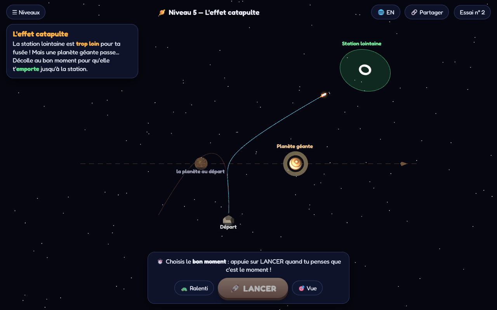
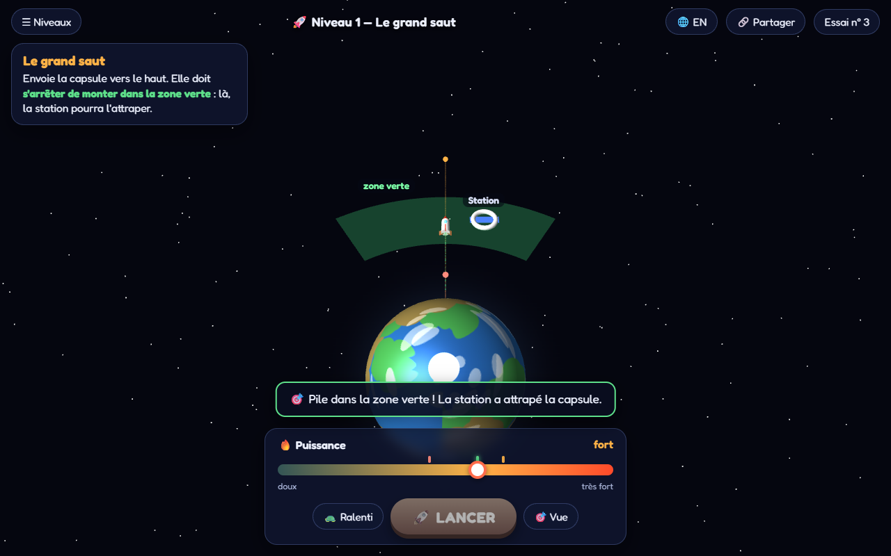
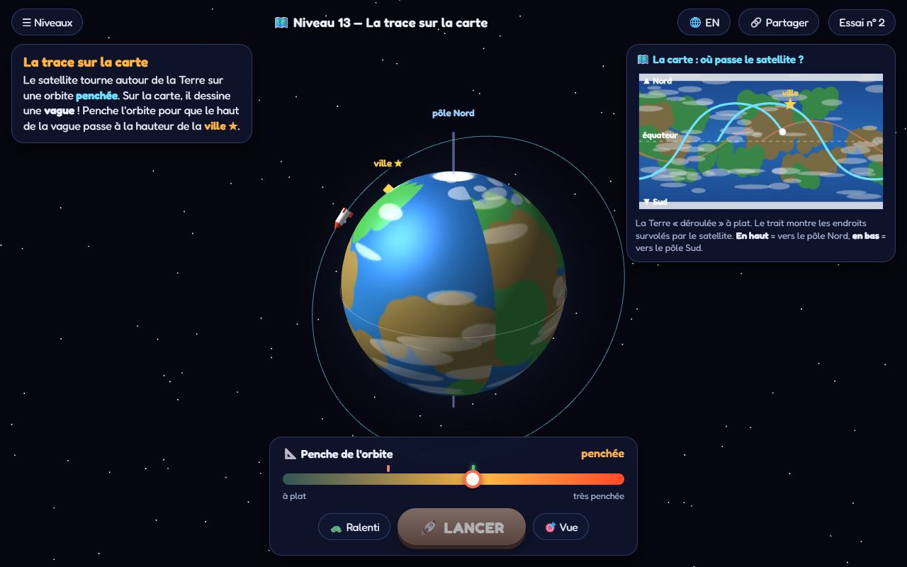
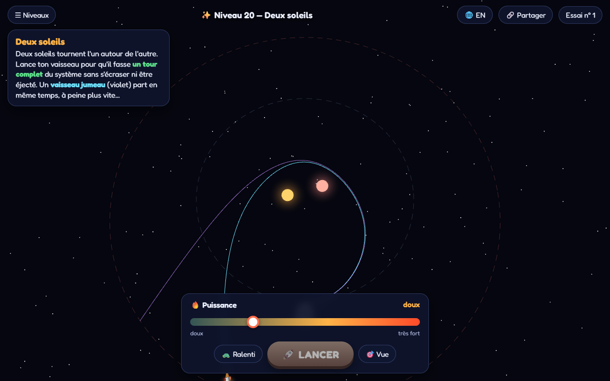

# ⭐ Star Nav

[English](README.md) · **Français**

**Un jeu 3D de navigation spatiale pour les enfants (vers 8 ans), qui donne l'intuition de la gravité et des trajectoires — sans une seule équation.**

### ▶ [Jouer maintenant : edu-fpar.github.io/star-nav](https://edu-fpar.github.io/star-nav/#niveau-1)

---

## L'idée

La mécanique des orbites, quand on la rencontre, c'est en général sous forme de formules. Star Nav prend le chemin inverse : **on essaie, on regarde ce qui se passe, on ajuste**.

- Chaque niveau propose **un ou deux réglages** (puissance, moment du départ, force du moteur…).
- Un essai raté reste affiché en **trace fantôme** : on corrige le suivant à l'œil.
- Les messages ne donnent jamais de chiffres : *« Presque ! Un tout petit peu plus fort »*, *« Trop tôt : tu es passé devant la planète »*.
- Après 3 échecs, un **indice** apparaît. Après une réussite, une carte **« Ce que tu viens de découvrir »** met l'idée en mots.

## Les 31 niveaux

Chaque titre ouvre directement le niveau.

**Partie 1 — Les bases**

| # | Niveau | Ce que l'enfant découvre |
|---|---|---|
| 1 | [🚀 Le grand saut](https://edu-fpar.github.io/star-nav/#niveau-1) | Plus on pousse fort, plus on monte… et au-delà d'une certaine vitesse, on s'échappe pour toujours |
| 2 | [📦 Une capsule plus lourde](https://edu-fpar.github.io/star-nav/#niveau-2) | La même poussée fait moins bouger un objet lourd |
| 3 | [🛰️ Faire le tour de la Terre](https://edu-fpar.github.io/star-nav/#niveau-3) | Un satellite tombe tout le temps — *autour* de la Terre |
| 4 | [🌙 Rendez-vous avec la Lune](https://edu-fpar.github.io/star-nav/#niveau-4) | Viser là où la Lune *sera*, pas là où elle est |
| 5 | [🪐 L'effet catapulte](https://edu-fpar.github.io/star-nav/#niveau-5) | Passer derrière une planète qui avance donne de la vitesse gratuite |

**Partie 2 — Naviguer dans l'espace**

| # | Niveau | Ce que l'enfant découvre |
|---|---|---|
| 6 | [🌊 Retour sur Terre](https://edu-fpar.github.io/star-nav/#niveau-6) | Pour redescendre, on freine — et longtemps à l'avance |
| 7 | [🏃 Rattraper la station](https://edu-fpar.github.io/star-nav/#niveau-7) | Le paradoxe : en orbite, pour rattraper quelqu'un, il faut ralentir |
| 8 | [🪜 Monter d'un étage](https://edu-fpar.github.io/star-nav/#niveau-8) | Deux coups de moteur, le second tout en haut de l'ovale |
| 9 | [🛬 Atterrir en douceur](https://edu-fpar.github.io/star-nav/#niveau-9) | Garder le moteur allumé pour freiner contre la gravité (attention au carburant) |
| 10 | [🔴 Cap sur Mars](https://edu-fpar.github.io/star-nav/#niveau-10) | La fenêtre de tir ne revient que de temps en temps |

**Partie 3 — Lire les graphiques**

| # | Niveau | Ce que l'enfant découvre |
|---|---|---|
| 11 | [📈 Dessiner le voyage](https://edu-fpar.github.io/star-nav/#niveau-11) | Un graphique, c'est le voyage dessiné dans le temps (des perles de couleur relient l'espace et la courbe) |
| 12 | [〰️ La vague de l'orbite](https://edu-fpar.github.io/star-nav/#niveau-12) | Une orbite ovale dessine une vague qui se répète ; une orbite ronde, une ligne plate |
| 13 | [🗺️ La trace sur la carte](https://edu-fpar.github.io/star-nav/#niveau-13) | Une orbite penchée dessine une vague sur une carte à plat — celle des posters de missions spatiales |

**Partie 4 — Plusieurs réglages**

| # | Niveau | Ce que l'enfant découvre |
|---|---|---|
| 14 | [⛽ Le plein de carburant](https://edu-fpar.github.io/star-nav/#niveau-14) | Le carburant pousse, mais il pèse : trop, et la fusée ne décolle plus |
| 15 | [👩‍🚀 Des astronautes à bord](https://edu-fpar.github.io/star-nav/#niveau-15) | Fort et court, ou doux et long : les humains ont besoin du doux. Un carnet de bord trace chaque essai |

**Partie 5 — Nouveaux défis**

| # | Niveau | Ce que l'enfant découvre |
|---|---|---|
| 16 | [📍 Survoler la ville](https://edu-fpar.github.io/star-nav/#niveau-16) | La penche *et* le moment du départ : la Terre tourne sous le satellite |
| 17 | [☄️ La catapulte perturbée](https://edu-fpar.github.io/star-nav/#niveau-17) | Toutes les planètes attirent : une deuxième peut te dévier |

**Partie 6 — Vers le problème à trois corps**

| # | Niveau | Ce que l'enfant découvre |
|---|---|---|
| 18 | [⚖️ Le point d'équilibre](https://edu-fpar.github.io/star-nav/#niveau-18) | Le tir à la corde de la gravité entre la Terre et la Lune (un point de Lagrange) |
| 19 | [♾️ Le grand huit](https://edu-fpar.github.io/star-nav/#niveau-19) | La Lune peut faire faire demi-tour à une fusée sans carburant (le « retour libre ») |
| 20 | [✨ Deux soleils](https://edu-fpar.github.io/star-nav/#niveau-20) | Le chaos : un vaisseau jumeau lancé 1 % plus vite finit tout autre part |

**Partie 7 — Missions spéciales**

| # | Niveau | Ce que l'enfant découvre |
|---|---|---|
| 21 | [🏓 Le ricochet sur l'air](https://edu-fpar.github.io/star-nav/#niveau-21) | Trop à plat, la capsule rebondit sur l'air ; trop raide, elle brûle : il faut viser le couloir entre les deux |
| 22 | [📡 Le satellite immobile](https://edu-fpar.github.io/star-nav/#niveau-22) | Plus un satellite est haut, plus son tour est long ; à la bonne hauteur, il tourne avec la Terre |
| 23 | [🧨 La fusée à étages](https://edu-fpar.github.io/star-nav/#niveau-23) | Un réservoir vide est un poids mort : le larguer au bon moment fait monter plus haut |
| 24 | [🛑 La catapulte à l'envers](https://edu-fpar.github.io/star-nav/#niveau-24) | Passer devant une planète freine : la même planète peut accélérer ou ralentir |
| 25 | [☄️ Dévier l'astéroïde](https://edu-fpar.github.io/star-nav/#niveau-25) | Une petite poussée donnée tôt vaut mieux qu'une grosse donnée tard (comme la mission DART) |

**Partie 8 — Les outils des ingénieurs**

Trois niveaux qui font toucher du doigt des idées qu'on retrouve ensuite dans les formations techniques (physique, programmation, robotique).

| # | Niveau | Ce que l'enfant découvre |
|---|---|---|
| 26 | [➕ Additionner les flèches](https://edu-fpar.github.io/star-nav/#niveau-26) | Une vitesse est une flèche : le coup de moteur s'ajoute bout à bout à la glissade (les **vecteurs**) |
| 27 | [🧮 L'ordinateur de bord](https://edu-fpar.github.io/star-nav/#niveau-27) | Un ordinateur calcule un trajet par sauts : trop grands, il se trompe ; trop petits, il est débordé (la **simulation pas à pas**) |
| 28 | [🤖 Le pilote automatique](https://edu-fpar.github.io/star-nav/#niveau-28) | Mesurer l'écart et corriger : sans amortisseur ça oscille, avec trop c'est lent (la **boucle de régulation**) |

**Partie 9 — Capteurs, messages et programmes**

| # | Niveau | Ce que l'enfant découvre |
|---|---|---|
| 29 | [📶 Le capteur qui grésille](https://edu-fpar.github.io/star-nav/#niveau-29) | Une mesure est toujours un peu fausse : faire la moyenne calme le bruit, mais crée du retard (le **filtrage**) |
| 30 | [📡 Le robot sur Mars](https://edu-fpar.github.io/star-nav/#niveau-30) | Un message met du temps à arriver : il faut envoyer l'ordre en avance (la **latence**) |
| 31 | [🧩 Programmer le robot](https://edu-fpar.github.io/star-nav/#niveau-31) | Écrire une suite d'instructions, repérer celle qui coince et la corriger (l'**algorithme** et le **débogage**) |

## Commandes

- **Faire glisser** l'écran pour tourner autour de la scène, **molette** (ou pincer) pour zoomer, **🎯 Vue** pour recentrer.
- **Barre d'espace** = lancer. Au niveau de l'atterrissage, garder le bouton (ou la barre d'espace) appuyé pour allumer le moteur.
- Au niveau 31, les **flèches du clavier** ajoutent des instructions (↑ avancer, ← gauche, → droite) et **Retour arrière** efface la dernière.
- **🐢 Ralenti** aide pour les niveaux « au bon moment ».
- **🌐 FR / EN** change de langue à tout moment. **🔗 Partager** copie le lien direct vers le niveau en cours.

## Liens directs et langue

- `#niveau-7` ouvre le niveau 7 en français, `#level-7` l'ouvre en anglais.
- Sans lien, le jeu suit la langue du navigateur et retient le dernier choix.

## Lancer le jeu chez soi

Il n'y a rien à compiler ni à installer : c'est un site statique.

- Ouvrir `index.html` dans un navigateur, ou servir le dossier avec n'importe quel serveur web local.
- Une connexion Internet est nécessaire pour le moteur 3D ([Three.js](https://threejs.org/) r128, chargé depuis cdnjs) et la police.

## Fichiers du projet

| Fichier | Rôle |
|---|---|
| `index.html` | Structure de la page |
| `style.css` | Apparence et mise en page |
| `game.js` | Physique, niveaux, scène 3D, graphiques |
| `i18n.js` | Traduction anglaise (phrase française → phrase anglaise, et textes des niveaux) |
| `screenshots/` | Images utilisées dans ces README |

**Modifier un niveau.** Les textes et réglages des niveaux sont dans le tableau `LEVELS`, en haut de `game.js`. Les textes anglais de chaque niveau sont dans `i18n.js`, dans le même ordre.

**Compléter la traduction.** Le français est écrit directement dans `game.js` ; `i18n.js` associe chaque phrase française à sa version anglaise. Quand le jeu tourne en anglais, une phrase pas encore traduite s'affiche en français et est signalée dans la console du navigateur (`[i18n] à traduire`).

## Licence et citation

© 2026 François Parlant — [CC BY-NC-SA 4.0](https://creativecommons.org/licenses/by-nc-sa/4.0/deed.fr). L'usage en classe et en formation est libre, en citant l'auteur ; vos adaptations se partagent sous la même licence. Voir [LICENSE](LICENSE).

**Usage commercial** (organisme de formation, éditeur, marque blanche, scénarios sur mesure, paquets SCORM personnalisés) : une licence commerciale est possible sur accord. [Me contacter](https://edu-fpar.github.io/about.html).

**Citer cet outil** (bouton *Cite this repository* de GitHub, d'après [CITATION.cff](CITATION.cff)) :

> Parlant, F. (2026). *Star Nav* [Logiciel pédagogique]. Zenodo. https://doi.org/10.5281/zenodo.24464415

Vous l'utilisez en cours ? [Dites-le-moi](https://www.linkedin.com/in/francois-parlant/) : ces retours m'aident à faire connaître et améliorer l'outil.
