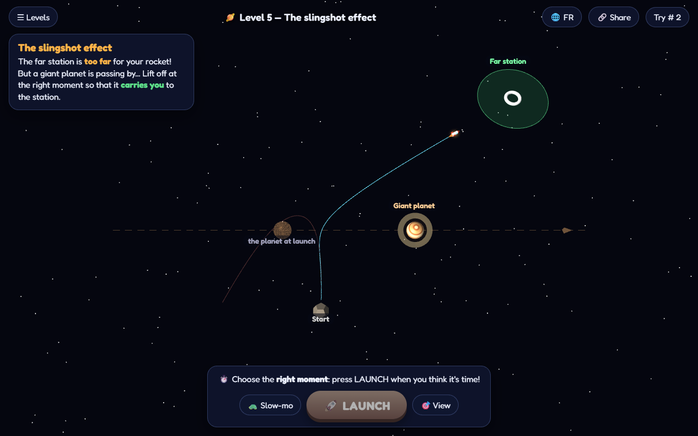
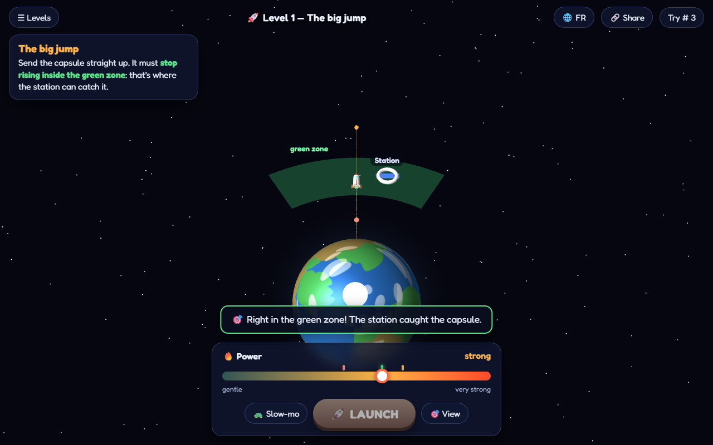
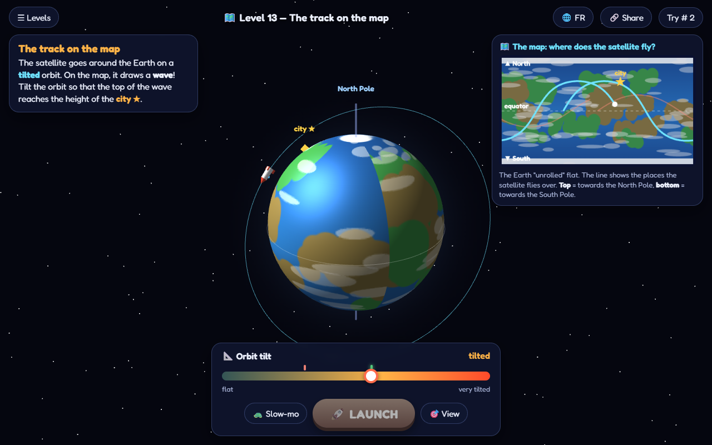
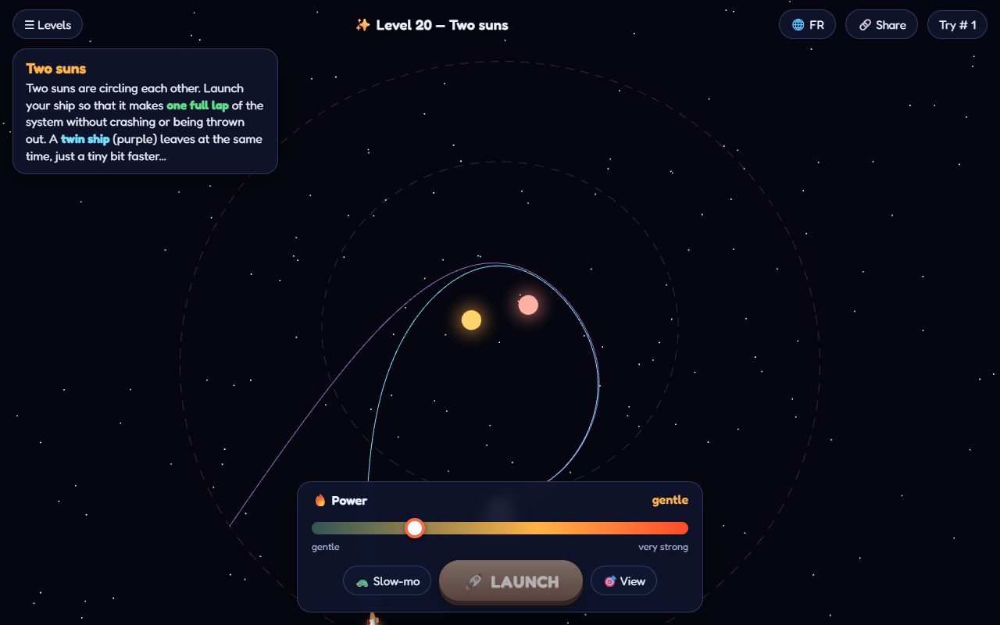

# ⭐ Star Nav

Source code: [github.com/edu-fpar/star-nav](https://github.com/edu-fpar/star-nav)

**English** · [Français](README.fr.md)

**A 3D space-navigation game for children (around 8 years old) that builds an intuition for gravity and trajectories — without a single equation.**

### ▶ [Play now: edu-fpar.github.io/star-nav](https://edu-fpar.github.io/star-nav/#level-1)

---

## The idea

Most of us met orbital mechanics, if ever, as a page of formulas. Star Nav takes the opposite path: **you try, you watch what happens, you adjust**.

- Each level has **one or two settings** (power, launch moment, engine force…).
- A missed attempt stays on screen as a **ghost line**, so the next try can be corrected by eye.
- Messages never give numbers: *"Almost! Just a tiny bit harder"*, *"Too early: you passed in front of the planet"*.
- After 3 failed tries, a **hint** appears. After a success, a short **"What you just discovered"** card puts the idea into words.

## The 31 levels

Each title opens the level directly.

**Part 1 — The basics**

| # | Level | What the child discovers |
|---|---|---|
| 1 | [🚀 The big jump](https://edu-fpar.github.io/star-nav/#level-1) | Push harder, go higher… and above a certain speed, escape forever |
| 2 | [📦 A heavier capsule](https://edu-fpar.github.io/star-nav/#level-2) | The same push moves a heavy object less |
| 3 | [🛰️ Around the Earth](https://edu-fpar.github.io/star-nav/#level-3) | A satellite is always falling — *around* the Earth |
| 4 | [🌙 Meet the Moon](https://edu-fpar.github.io/star-nav/#level-4) | Aim where the Moon *will be*, not where it is |
| 5 | [🪐 The slingshot effect](https://edu-fpar.github.io/star-nav/#level-5) | Passing behind a moving planet gives you free speed |

**Part 2 — Moving around in space**

| # | Level | What the child discovers |
|---|---|---|
| 6 | [🌊 Back to Earth](https://edu-fpar.github.io/star-nav/#level-6) | To come down, you brake — well in advance |
| 7 | [🏃 Catch the station](https://edu-fpar.github.io/star-nav/#level-7) | The paradox: to catch up in orbit, you must slow down |
| 8 | [🪜 Go up a level](https://edu-fpar.github.io/star-nav/#level-8) | Two burns, the second one at the top of the oval |
| 9 | [🛬 Soft landing](https://edu-fpar.github.io/star-nav/#level-9) | Hold the engine to brake against gravity (and watch the fuel) |
| 10 | [🔴 Next stop: Mars](https://edu-fpar.github.io/star-nav/#level-10) | The launch window only comes back every now and then |

**Part 3 — Reading graphs**

| # | Level | What the child discovers |
|---|---|---|
| 11 | [📈 Drawing the journey](https://edu-fpar.github.io/star-nav/#level-11) | A graph is the journey drawn over time (coloured beads link space and graph) |
| 12 | [〰️ The orbit wave](https://edu-fpar.github.io/star-nav/#level-12) | An oval orbit draws a repeating wave; a round one, a flat line |
| 13 | [🗺️ The track on the map](https://edu-fpar.github.io/star-nav/#level-13) | A tilted orbit draws a wave on a flat map — the one on space mission posters |

**Part 4 — Several settings**

| # | Level | What the child discovers |
|---|---|---|
| 14 | [⛽ Fill her up](https://edu-fpar.github.io/star-nav/#level-14) | Fuel pushes, but it is heavy: too much and the rocket can't lift off |
| 15 | [👩‍🚀 Astronauts on board](https://edu-fpar.github.io/star-nav/#level-15) | Strong-and-short or gentle-and-long; humans need the gentle one. A logbook plots every try |

**Part 5 — New challenges**

| # | Level | What the child discovers |
|---|---|---|
| 16 | [📍 Fly over the city](https://edu-fpar.github.io/star-nav/#level-16) | Tilt *and* launch moment: the Earth turns under the satellite |
| 17 | [☄️ The disturbed slingshot](https://edu-fpar.github.io/star-nav/#level-17) | Every planet pulls: a second one can knock you off course |

**Part 6 — Towards the three-body problem**

| # | Level | What the child discovers |
|---|---|---|
| 18 | [⚖️ The balance point](https://edu-fpar.github.io/star-nav/#level-18) | A gravity tug of war between Earth and Moon (a Lagrange point) |
| 19 | [♾️ The figure of eight](https://edu-fpar.github.io/star-nav/#level-19) | The Moon can turn a rocket around for free (the "free return") |
| 20 | [✨ Two suns](https://edu-fpar.github.io/star-nav/#level-20) | Chaos: a twin ship launched 1 % faster ends up somewhere else entirely |

**Part 7 — Special missions**

| # | Level | What the child discovers |
|---|---|---|
| 21 | [🏓 Bouncing off the air](https://edu-fpar.github.io/star-nav/#level-21) | Too flat and the capsule bounces off the air; too steep and it burns: aim for the corridor in between |
| 22 | [📡 The satellite that stands still](https://edu-fpar.github.io/star-nav/#level-22) | The higher a satellite, the longer its lap; at the right height it turns with the Earth |
| 23 | [🧨 The multi-stage rocket](https://edu-fpar.github.io/star-nav/#level-23) | An empty tank is dead weight: dropping it at the right moment takes you higher |
| 24 | [🛑 The backwards slingshot](https://edu-fpar.github.io/star-nav/#level-24) | Passing in front of a planet slows you down: the same planet can speed you up or brake you |
| 25 | [☄️ Push the asteroid aside](https://edu-fpar.github.io/star-nav/#level-25) | A small push given early beats a big one given late (like the DART mission) |

**Part 8 — Engineers' tools**

Three levels that give a first feel for ideas met later in technical courses (physics, programming, robotics).

| # | Level | What the child discovers |
|---|---|---|
| 26 | [➕ Adding arrows](https://edu-fpar.github.io/star-nav/#level-26) | A speed is an arrow: the engine burn is added end to end to the drift (**vectors**) |
| 27 | [🧮 The onboard computer](https://edu-fpar.github.io/star-nav/#level-27) | A computer works out a path in jumps: too big and it goes wrong, too small and it is overloaded (**step-by-step simulation**) |
| 28 | [🤖 The autopilot](https://edu-fpar.github.io/star-nav/#level-28) | Measure the gap and correct it: no damper and it wobbles, too much and it is slow (the **control loop**) |

**Part 9 — Sensors, messages and programs**

| # | Level | What the child discovers |
|---|---|---|
| 29 | [📶 The crackling sensor](https://edu-fpar.github.io/star-nav/#level-29) | A measurement is always a bit wrong: averaging calms the noise but adds delay (**filtering**) |
| 30 | [📡 The robot on Mars](https://edu-fpar.github.io/star-nav/#level-30) | A message takes time to arrive: the order must be sent ahead of time (**latency**) |
| 31 | [🧩 Program the robot](https://edu-fpar.github.io/star-nav/#level-31) | Write a list of instructions, find the one that fails and fix it (**algorithms** and **debugging**) |

## Controls

- **Drag** the screen to turn around the scene, **scroll** (or pinch) to zoom, **🎯 View** to reset.
- **Space bar** = launch. On the landing level, hold the button (or the space bar) to fire the engine.
- In level 31, the **arrow keys** add instructions (↑ forward, ← left, → right) and **Backspace** deletes the last one.
- **🐢 Slow-mo** helps on the "right moment" levels.
- **🌐 FR / EN / ES** switches language at any time (French → English → Spanish). **🔗 Share** copies a direct link to the current level.

## Direct links and language

- `#level-7` opens level 7 in English, `#niveau-7` in French, `#nivel-7` in Spanish.
- Without a link, the game follows the browser's language and remembers the last choice.

## Running it locally

There is nothing to build or install: it's a static site.

- Open `index.html` in a browser, or serve the folder with any local web server.
- An Internet connection is needed for the 3D engine ([Three.js](https://threejs.org/) r128, loaded from cdnjs) and the font.

## Project files

| File | Role |
|---|---|
| `index.html` | Page structure |
| `style.css` | Look and layout |
| `game.js` | Physics, levels, 3D scene, graphs |
| `i18n.js` | English translation (French sentence → English sentence, plus level texts) |
| `i18n.es.js` | Spanish translation (same structure) |
| `screenshots/` | Images used in these READMEs |

**Editing a level.** Level texts and settings live in the `LEVELS` array at the top of `game.js`. The English and Spanish texts of each level are in `i18n.js` and `i18n.es.js`, in the same order.

**Adding a translation.** French is written directly in `game.js`. `i18n.js` maps each French sentence to its English version, `i18n.es.js` to its Spanish version. When the game runs in English or Spanish, any sentence that hasn't been translated yet is shown in French and reported in the browser console (`[i18n] à traduire`).

## License and citation

© 2026 François Parlant — [CC BY-NC-SA 4.0](https://creativecommons.org/licenses/by-nc-sa/4.0/). Using it in class or in training is free, with credit to the author; adaptations must be shared under the same license. See [LICENSE](LICENSE).

**Commercial use** (training company, publisher, white label, custom scenarios, tailored SCORM packages): a commercial license is available by agreement. [Get in touch](https://edu-fpar.github.io/about.html?lang=en).

**How to cite** (GitHub's *Cite this repository* button, from [CITATION.cff](CITATION.cff)):

> Parlant, F. (2026). *Star Nav* [Educational software]. Zenodo. https://doi.org/10.5281/zenodo.24464415

Using it in class? [Let me know](https://www.linkedin.com/in/francois-parlant/): this feedback helps me improve the tool and spread the word.
